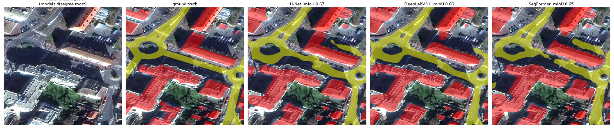
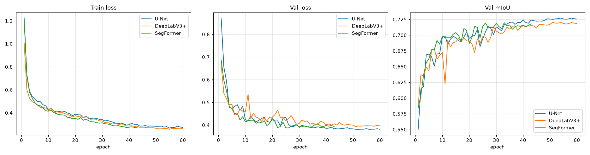

# Building, Road and Land Segmentation in Aerial/Satellite Images

Pixel-level semantic segmentation of satellite imagery into three classes — **land**, **road** and **building** — using the SpaceNet Paris dataset, with a comparison of three segmentation architectures: **U-Net**, **DeepLabV3+** and **SegFormer**.

> Course project: *Hava ve Uydu Görüntülerinde Yapı ve Arazi Segmentasyonu*



*Test tile `AOI_3_Paris_img864`: image | ground truth | U-Net | DeepLabV3+ | SegFormer (road yellow, building red).*

**Headline result:** all three models reach ~0.725 test mIoU — a tie. SegFormer matches the CNNs with about half the parameters.

> **Note:** the dataset, raw downloads and trained checkpoints are **not** included in this repository because of their size. See [How to run](#how-to-run) to download the data and reproduce the results.

---

## Task

Given an overhead image, assign every pixel one of these labels:

| Value | Class | Overlay color |
|---|---|---|
| 0 | Land / background | none |
| 1 | Road | yellow |
| 2 | Building | red |
| 255 | No-data (ignored in loss and metrics) | gray |

Several architectures are trained under identical conditions and compared on accuracy and efficiency.

---

## Dataset

**SpaceNet — Paris AOI (AOI_3_Paris)**, WorldView-3 imagery at ~0.3 m/pixel, from the public `spacenet-dataset` S3 bucket.

- **Images + building labels:** SpaceNet 2 (SN2) — 1,148 RGB-PanSharpen tiles, 650×650 px, 16-bit.
- **Road labels:** SpaceNet 3 (SN3) — road centerlines as GeoJSON (LineStrings), with lane counts.

The SpaceNet "Paris" area covers the northern suburbs of Paris, not the city center.

### Data preparation

1. **8-bit conversion:** 2–98 percentile stretch per band, with percentiles computed over a shared sample of tiles so all tiles use the same scaling.
2. **Road width:** centerlines are buffered in a metric CRS (EPSG:32631, UTM 31N) to `lane_number × 3.5 m`, clamped to 3–20 m (2 lanes assumed if missing).
3. **Rasterizing:** roads (1) are drawn first, then buildings (2), so buildings win on overlap.
4. **Road label coverage filter:** SN2 and SN3 use different tile grids, and road labels exist only inside the SN3 footprint. Tiles less than 98% inside that footprint were dropped, because their real roads would otherwise be labeled as land.
5. **No-data:** pixels where all RGB bands are 0 get value 255. Tiles that are more than 50% no-data were dropped.

| Step | Tiles |
|---|---|
| SN2 Paris tiles | 1,148 |
| − outside road-label coverage | −473 |
| − more than 50% no-data | −58 |
| **Final dataset** | **617** |

**Split** (random by tile, seed 42; tiles have zero overlap):

| Split | Tiles | Land % | Road % | Building % |
|---|---|---|---|---|
| Train | 432 | 87.36 | 5.60 | 7.04 |
| Val | 93 | 86.93 | 5.97 | 7.10 |
| Test | 92 | 88.27 | 5.18 | 6.55 |

---

## Models and training

All models use `segmentation-models-pytorch` with ImageNet-pretrained encoders and 3 output classes.

| Model | Encoder | Parameters |
|---|---|---|
| U-Net | ResNet-34 | 24.4M |
| DeepLabV3+ | ResNet-34 | 22.4M |
| SegFormer | MiT-B1 | 13.7M |

Identical training settings for all models:

- Input: random 512×512 crops (train), center crop (val/test)
- Augmentation: horizontal/vertical flips, 90° rotations, light brightness/contrast
- Loss: Cross-Entropy + Dice (multiclass), both ignoring 255
- Optimizer: AdamW (lr 3e-4, weight decay 1e-4), cosine LR schedule, mixed precision
- Batch size 8, up to 60 epochs, early stopping (patience 10 on val mIoU), seed 42
- Hardware: Kaggle, NVIDIA T4 GPU

---

## Results

### Training (validation set)

| Model | Best val mIoU | Best epoch | Epochs run | Train time |
|---|---|---|---|---|
| U-Net | 0.7271 | 54 | 60 | 15.2 min |
| DeepLabV3+ | 0.7203 | 51 | 60 | 12.3 min |
| SegFormer | 0.7198 | 33 | 43 (early stop) | 10.4 min |

### Test set (92 tiles)

| Model | mIoU | Mean Dice | Pixel acc. | IoU land | IoU road | IoU building |
|---|---|---|---|---|---|---|
| U-Net | 0.725 | 0.831 | 0.947 | 0.942 | 0.565 | **0.670** |
| DeepLabV3+ | 0.724 | 0.831 | 0.947 | 0.942 | **0.580** | 0.651 |
| SegFormer | 0.725 | 0.831 | 0.945 | 0.940 | 0.577 | 0.657 |

Per-class precision/recall: [`results/metrics.md`](results/metrics.md). Confusion matrices: `results/confusion_<model>.png`.



### Efficiency

CPU time measured on a laptop CPU (batch 1, 512×512); not representative of GPU speed.

| Model | Parameters | Checkpoint | CPU ms/image |
|---|---|---|---|
| U-Net | 24.4M | 97.9 MB | 386 |
| DeepLabV3+ | 22.4M | 89.9 MB | 525 |
| SegFormer | 13.7M | 54.8 MB | 428 |

### Findings

- **Overall the three models tie** (mIoU 0.724–0.725). With 92 test tiles, a 0.001 difference is well within noise.
- **Land** is easy for all models (IoU ≈ 0.94). **Road** is the hardest class (IoU ≈ 0.57).
- Per class, DeepLabV3+ is slightly best on roads and U-Net slightly best on buildings — the opposite of our initial hypothesis, though the gaps are small (~0.015 IoU).
- **SegFormer** matches the CNNs' accuracy with about half the parameters and converges earliest.
- Very different architectures reaching the same score suggests that **data and labels, not architecture, limit performance** here.

### Typical errors

- Roads predicted as thick, blobby regions, merging with parking areas and plazas.
- Roads missed or only partly found on rural tiles.
- Blurred building boundaries; misses on small or very bright roofs.

### Limitations

- **Road labels are approximate:** centerlines buffered to an estimated width, so mask edges don't match true road edges.
- **Road definition:** parking aisles are labeled as roads, but plazas and parking lots are not.
- **Small dataset:** 432 training tiles, limited by road-label coverage. Transformers in particular tend to benefit from more data.
- **Small test set:** 92 tiles, so small differences between models are not statistically meaningful.
- U-Net and DeepLabV3+ were still improving near epoch 60 and may gain slightly with longer training.

---

## Project structure

```
SpaceNet_Segmentation/
├── data/
│   ├── raw/            # downloaded SpaceNet archives (not tracked)
│   ├── images/         # 8-bit RGB tiles (PNG)
│   ├── masks/          # label masks, values 0/1/2/255 (PNG)
│   ├── tiles.csv       # per-tile coverage, class %, kept flag, drop reason
│   └── splits.csv      # tile_id → train / val / test
├── src/
│   ├── coverage.py     # SN3 road-label coverage per tile
│   ├── build_dataset.py# 8-bit conversion, rasterizing, filtering
│   ├── check_masks.py  # overlay images for visual checks
│   ├── split.py        # train/val/test split
│   ├── dataset.py      # PyTorch Dataset + augmentations
│   ├── check_dataset.py# augmentation alignment check
│   ├── train.py        # training (--model unet | deeplabv3plus | segformer)
│   └── evaluate.py     # test-set metrics, confusion matrices, prediction figures
├── notebooks/
│   ├── 01_download.ipynb
│   ├── 02_make_masks.ipynb
│   ├── 03_train_kaggle.ipynb
│   └── 04_evaluate.ipynb
├── models/             # trained checkpoints (not tracked; see "Pretrained checkpoints")
├── results/            # logs, metrics, curves, confusion matrices, predictions
├── kaggle_upload/      # spacenet_data.bin for Kaggle
├── app.py              # Gradio demo
├── requirements.txt
└── LICENSE
```

---

## How to run

### 1. Setup

```bash
git clone <this-repo-url>
cd SpaceNet_Segmentation
python -m venv .venv
.venv\Scripts\activate          # Windows
pip install -r requirements.txt
```

### 2. Download data (no AWS account needed)

```bash
aws s3 cp s3://spacenet-dataset/spacenet/SN2_buildings/tarballs/SN2_buildings_train_AOI_3_Paris.tar.gz data/raw/ --no-sign-request
aws s3 cp s3://spacenet-dataset/spacenet/SN3_roads/tarballs/SN3_roads_train_AOI_3_Paris_geojson_roads_speed.tar.gz data/raw/ --no-sign-request
aws s3 cp s3://spacenet-dataset/spacenet/SN3_roads/tarballs/SN3_roads_train_AOI_3_Paris.tar.gz data/raw/ --no-sign-request
```

The last file (SN3 imagery) is only used to compute the road-label coverage area.

### 3. Build the dataset

Run `notebooks/02_make_masks.ipynb`, which calls `coverage.py` → `build_dataset.py` → `check_masks.py` → `split.py`.

### 4. Train

Locally (GPU recommended):

```bash
python src/train.py --model unet --data_dir data --out_dir .
```

On Kaggle: upload `kaggle_upload/spacenet_data.bin` as a dataset (the `.bin` extension stops Kaggle from auto-extracting it into thousands of small files), add it to `notebooks/03_train_kaggle.ipynb`, enable a GPU and internet, and use **Save & Run All**.

### 5. Evaluate

Place the checkpoints in `models/` and the logs in `results/`, then either run `notebooks/04_evaluate.ipynb` or:

```bash
cd src
python evaluate.py
```

This writes `results/metrics.csv`, `metrics.md`, `training_curves.png`, `confusion_<model>.png` and `predictions/`.

### Pretrained checkpoints

The three trained checkpoints (`unet_best`, `deeplabv3plus_best`, `segformer_best`; 55–98 MB each) are too large to track in git. Put them in `models/` as `<model>_best.pth` (a `.zip` extension also works; the code loads either). You can also retrain them with step 4.

### 6. Demo

```bash
python app.py
```

Open the local URL shown (e.g. `http://127.0.0.1:7860`). Pick a test tile or upload an image to see all three models' predictions side by side. Images from other sources (different city, zoom or colors) will generally give worse results than the Paris test tiles.

---

## References

- SpaceNet: https://spacenet.ai/ — data on AWS: https://registry.opendata.aws/spacenet/
- Van Etten, Lindenbaum, Bacastow, *SpaceNet: A Remote Sensing Dataset and Challenge Series*, 2018. arXiv:1807.01232
- Ronneberger et al., *U-Net: Convolutional Networks for Biomedical Image Segmentation*, 2015
- Chen et al., *Encoder-Decoder with Atrous Separable Convolution for Semantic Image Segmentation* (DeepLabV3+), 2018
- Xie et al., *SegFormer: Simple and Efficient Design for Semantic Segmentation with Transformers*, 2021
- segmentation-models-pytorch: https://github.com/qubvel-org/segmentation_models.pytorch

## License

Code: [MIT](LICENSE). SpaceNet data is licensed under CC BY-SA 4.0 and is not redistributed here.
